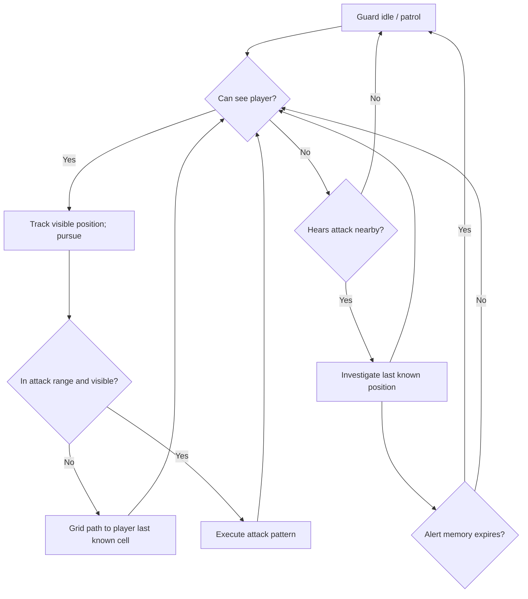

# Ashvault Enemy Roster and AI Behaviour — Expansion Prototype

*Numbers are first-pass **design values** taken from `EnemyCatalog.cs`, not experimentally balanced or playtested. Distances are Unity world units; speeds are world units/second. Affected by collision and sector navigation. All image sprites are original temporary art.*

## Classes of enemy and combat roles

| Enemy | Episode | Classification | HP | Speed | Sight | Attack range | Damage | Cooldown | Combat action |
| --- | --- | --- | ---: | ---: | ---: | ---: | ---: | ---: | --- |
| Crypt Reaver | I | Grunt | 85 | 3.25 | 22 | 2.4 | 13 | 1.25s | Direct melee swipe |
| Bone Runner | I | Skirmisher | 57 | 5.3 | 27 | 2.3 | 9 | 0.82s | Fast melee chase |
| Hex Cultist | I | Ranged | 70 | 2.6 | 28 | 14 | 12 | 1.72s | Aimed arcane bolt |
| Iron Warden | I | Brute | 220 | 2.1 | 25 | 2.8 | 26 | 3.1s | Windup then charge |
| Grave Hound | II | Skirmisher | 76 | 5.6 | 28 | 2.4 | 12 | 0.95s | Fast pouncing melee |
| Fen Wisp | II | Flying | 60 | 3.9 | 29 | 13 | 9 | 2.2s | 3-orb magic volley, hover sprite |
| Plague Shaman | II | Summoner | 110 | 2.0 | 28 | 13 | 10 | 2.6s | Bolts plus Grave Hound reinforcements |
| Moss Golem | II | Brute | 270 | 1.8 | 24 | 2.85 | 32 | 3.3s | High-damage telegraphed charge |
| Void Stalker | III | Skirmisher | 105 | 5.0 | 30 | 2.5 | 18 | 1.05s | Relentless melee hunt |
| Astral Adept | III | Ranged | 96 | 2.9 | 32 | 15 | 12 | 2.2s | 3-bolt fan |
| Star Sentinel | III | Brute | 320 | 2.0 | 30 | 3 | 34 | 3.5s | Heavy charge |
| Rift Summoner | III | Summoner | 145 | 2.4 | 34 | 15 | 17 | 2.3s | Bolt / Void Stalker summons |
| **The Ember King** | I-3 | Boss | 850 | 2.55 | 42 | 21 | 25 | 2.15s | 3/5-bolt spread, hazard & Bone Runner summons |
| **Mother of the Mire** | II-3 | Boss | 1050 | 2.25 | 42 | 20 | 27 | 2.3s | 3/5-bolt spread, hazard & Fen Wisp summons |
| **The Starless Lich** | III-3 | Boss | 1250 | 3.0 | 45 | 23 | 31 | 1.85s | 3/5-bolt spread, hazard & Void Stalker summons |

## AI flow

**Sight** uses a forward FOV test before alert and Unity physics line-of-sight raycasts; a wall or unopened door blocks sight. If spotted, the enemy memorises the location. Attacks and impacts alert nearby enemies (radius 20 units by default), causing investigation. Alert expires after 9 seconds (bosses: 25 seconds) without reacquiring the player. When the player moves behind cover, the enemy attempts to path to the **last known cell**; it does not have omniscient pursuit when sight is lost.

**Navigation** is a 4-neighbour corridor BFS on `DungeonMap`. The same class doors, sigil locks, secret walls and sector height thresholds used to build level geometry block navigation. Doors only become traversable once their opening animation completes. Paths are recalculated periodically (~0.62–0.88 seconds). This is a straightforward prototype pathfinder and has not been profiled on iOS.

**Patrols** have designated home spawn points and short waypoint searches; **guards** stay at their map position until alerted. **Ambush anchors** spawn their enemy when the player comes within 14 units. Ranged, flying, summoner and boss enemies strafe or retreat at short distances. Flying enemies are grounded from a navigation perspective with a visually hovering billboard; true 3D flying paths are a future feature.

## Boss phase changes

| Phase | HP remaining | Changes |
| --- | --- | --- |
| 1 | 100–67% | Default cooldown, aimed 3-bolt fan |
| 2 | 66–35% | ~18% shorter attack cooldown, 5-bolt fan, 2 spawned helpers, ground attack every third attack |
| 3 | 34–0% | ~35% shorter cooldown, 5-bolt fan, 3 extra helpers, larger ground warning |

Chargers pause for a **0.68-second tell**, then move forward quickly for **0.56 seconds**; contact damage is applied only once per charge. Boss ground warnings last **1.2 seconds** before a circular damage check. Summoner and boss reinforcements increment the kill total dynamically.

## Spawn placements

Source-of-truth JSON files: `Assets/Ashvault/Resources/Maps/E01_L01.json` through `E03_L03.json`. Every enemy entry has `(x,z)`, an `EnemyArchetype`, and a mode of `Guard`, `Patrol`, `Ambush` or `Boss`. The level files include **135 authored spawn anchors**; **three of those** are boss encounters. Boss summons are additional dynamic spawns and are not included in the CSV.

See `ENEMY_SPAWNS.csv` for precise world cell coordinates, with world X and Z computed at **3 Unity units per cell**. Placement and line-of-sight should be tuned after playtesting.

## Deferred combat features

- Animated directional sprites (front/side/back walk, attack, pain, death).
- Audio perception, staged alarm groups, sound propagation beyond sphere hearing.
- Smarter cover selection, obstruction-aware ranged positioning, avoidance and combat formation.
- More than one charge path, separate boss phase art, cutscene intros, environmental hazards.
- Difficulty-dependent enemy health/speed/damage and platform-specific performance profiles.
