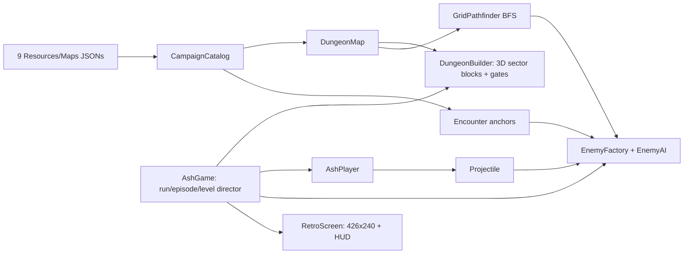

# Ashvault — Runtime Architecture and Validation

## Data, flow and runtime graph

`CampaignCatalog.cs` and `DungeonMap.cs` are combined in `CampaignMap.cs`; runtime content is driven from JSON rather than hardcoded enemy coordinates.

### Main scripts

| File | Responsibility |
| --- | --- |
| `AshGame.cs` | Select episode/class, level load/unload, key resets, kill/secret counts, boss tracking, run progression, player carry, pause |
| `CampaignMap.cs` | Deserialize level JSON, world-cell conversion, walkability, dynamic seal opening, four-way grid navigation |
| `DungeonBuilder.cs` | 3D raised floor/low-ceiling sectors, walls, pillars, arches, torches, interactable gates, pickups, enemy spawn anchors |
| `GameTypes.cs` | Eight class archetypes, primary/secondary weapon specifications, per-class perks and stats |
| `AshPlayer.cs` | CharacterController, FPS camera, movement/aim, attack and interaction, inventory carry, perks/damage |
| `EnemyCatalog.cs` | Fifteen enemy archetypes, attack and movement categories, HP/speed/range/damage definitions |
| `EnemyAI.cs` | Sight, hearing, patrol, pursuit/repath, attacks, boss phases, reinforcements, delayed encounter spawning |
| `Projectile.cs` | Animated 2D sprite-based physics sweeps, contact damage, blast radius, friendly and hostile shots |
| `WorldObjects.cs` | Interactable rising doors, concealed sliding wall, sigils, class loot, health, exit portal |
| `VisualFactory.cs` | Point-sampled sprite/material creation and 2D monster camera-facing orientation |
| `RetroScreen.cs` | Retro low-resolution framebuffer, 8-class/3-episode menu, boss bar, end-level/continue flow, mobile prototype buttons |
| `Editor/AshvaultSceneMenu.cs` | Prototype scene creation and build scene registration |
| `Editor/AshvaultCampaignValidationMenu.cs` | In-Editor topology checking against the actual C# pathfinder |

### Files and source-of-truth rule

Level JSON: `Assets/Ashvault/Resources/Maps/E??_L??.json`.

The 2D ASCII rows use the **same cells for three purposes**: mesh geometry, physics gates and grid pathfinding. A key/class door or secret is a blocked graph node until its physical animation completes, at which point `DungeonMap.Unseal(x,z)` enables movement. This eliminates hand-maintained nav-mesh mismatch for grid-authored levels but does not solve dynamic collision or steering by itself.

### Enemy model

- `EnemySpec`: immutable per-archetype values.
- `EnemyAI.Awareness`: Dormant, Patrolling, Investigating, Hunting, Windup, Charging, Dead.
- `HasSight`: distance/FOV + Physics.Raycast for actual line-of-sight.
- `Hear`: player attack raises alert to enemies in radius.
- `GridPathfinder.Find`: breadth-first search with no diagonal connections, 0.43m maximum step height. Repath time jitter prevents every AI recalculating simultaneously.
- Patrols choose short home-adjacent points; the player is pursued while visible, otherwise the AI investigates its last observed/heard position.
- Bosses use phase thresholds and `BossHazard` telegraphed damage, plus `EnemyFactory` reinforcements.

### Navigation design notes

- `DungeonMap.IsOpen` blocks unopened doors and secrets, but once an opening completes it remains open for the whole level.
- Pathfinding does not yet consider unit-to-unit collision, hazard avoidance, moving elevators, moving doors before completion or line-of-fire optimization.
- During pursuit a melee unit may crowd corridors and ranged units may attempt to strafe into walls; physics prevents clipping but tactical movement needs later improvement.
- BFS allocates temporary arrays per search. Consider native/jobified, flow-field, cached corridor graph or A* as enemy counts grow, particularly for iOS.

### Performance and mobile preparation

- Current approach generates many cube GameObjects and MeshRenderers; implement merged geometry, per-sector mesh UVs, material atlas, static batching, occlusion culling and dynamic-object pooling.
- Keep the retro render at 426×240 or offer configurable internal resolutions. Measure draw calls and scene-building time on real devices.
- Replace IMGUI with uGUI/UIToolkit using safe areas, touch gesture tuning and configurable bindings.
- Profile each map's complete load/unload cycle for stale objects, unexpected allocations and AudioListeners/cameras.
- For store release, add settings, accessibility, saves, sound effects/music, animation states, gamepad support, platform compliance and proper licensing.

## Validation and acceptance checklist

### Automated (completed without Unity)

- [x] Nine JSON level assets exist, each with a distinct topology.
- [x] Each map's three sigils and exit are reachable for all eight classes (72 simulations).
- [x] All 27 secrets can be reached by every class.
- [x] Every class cache is reachable across all maps.
- [x] Every authored enemy coordinate is on a non-wall cell.
- [x] Each episode finale has exactly one boss archetype.
- [x] All enemy/weapon textures referenced from C# exist.
- [x] Source tokens have balanced brackets and braces (a structural check, not a C# compile).

### Editor/device validation (NOT completed)

- [ ] Project imported and all C# scripts compiled with Unity 6000.6.10f1.
- [ ] `Tools > Ashvault > Validate All Nine Campaign Maps` passes inside Unity.
- [ ] Gameplay camera, HUD, class menu and touch bindings work on each target.
- [ ] All eight classes open only their designated class gates.
- [ ] Keys and all-sigils exit gates animate and update navigation correctly.
- [ ] Raised floors/low ceilings don't trap a player or an AI and all secrets open.
- [ ] Enemies acquire visible players, investigate shots and repath around sealed doors.
- [ ] Projectile collisions and radial damage behave correctly, including through/around cover.
- [ ] Brute charge windups, summon limits, boss phase thresholds and finale exit checks function.
- [ ] Health and weapon carry across level transitions works; retry/reset clears state.
- [ ] 3×3 full-playthrough with each class; no deadlocks.
- [ ] Windows and macOS native builds plus Steam-ready target build.
- [ ] iPhone/iPad landscape testing, safe areas, memory and GPU/CPU profiling.

**Not a shipping build:** none of the above Editor/device checks were run in this environment.
